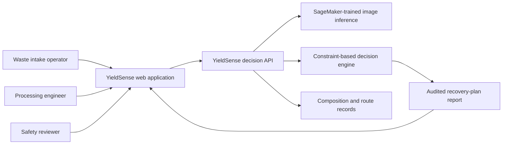
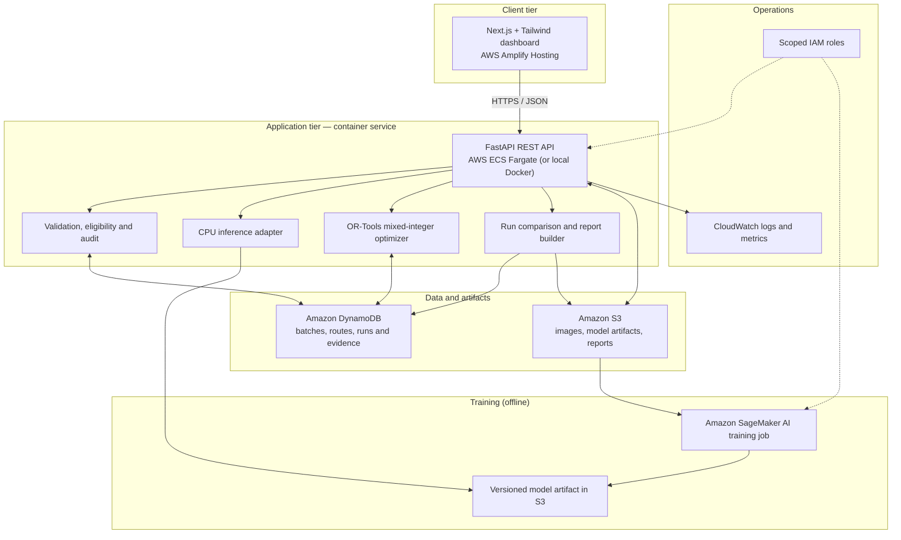
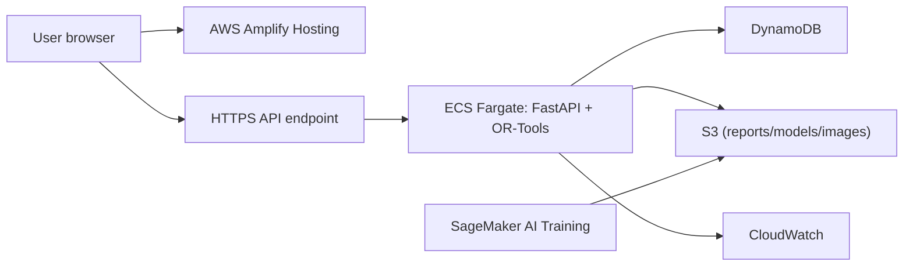

# YieldSense 2.0 — High-Level Design (HLD)

> **System:** Uncertainty-Aware E-Waste Recovery Route Optimization  
> **Document:** High-Level Design · **Revision:** 1.0 · **Date:** 2026-10-09  
> **Status:** Implementation-ready reference architecture for a 24–48-hour AWS hackathon  
> **Companion:** [`YieldSense_LLD.md`](YieldSense_LLD.md) · **Source plan:** `YieldSense_Implementation_Guide.md`

---

## 1. Executive summary

YieldSense is a **decision-support digital twin** for electronic-waste (WEEE) processing operators. It combines a **measured batch weight**, traceable information about likely material composition, an explicitly modeled **uncertainty set**, and facility economics/capacity to select the **highest-value eligible recovery route** for each batch. It reports expected and conservative modeled net value, baseline comparisons, and reasons why assignments are constrained or impossible.

The core question is: **Can uncertainty-aware route assignment improve risk-adjusted recoverable value compared with fixed-routing, greedy, and expected-value optimization while respecting processor eligibility, capacity, and safety-review constraints?**

The MVP **does not physically separate or recycle material**, assay precious metals, automatically certify hazardous-waste compliance, or claim measured savings without actual prices/yields. Costs and yields supplied solely for demonstrations are prominently labeled **synthetic assumptions**.

### 1.1 Primary objectives

1. Import or create **10–30 weighed batches**, with category and traceable source information.
2. Produce an appropriate composition estimate with **source attribution** and a reproducible set of plausible compositions.
3. Train or run **at least one authentic SageMaker AI model job** and preserve model/job evidence.
4. Compare **fixed-route, mean-greedy, expected-value MILP, and robust MILP** policies on the *same* lots, capacities, safety rules and scenarios.
5. Demonstrate a **price shock or processor shutdown** without violating constraints, showing *INFEASIBLE* when no eligible route exists.
6. Export an audit-friendly decision report listing assumptions, model/data versions, solver status, and limitations.

### 1.2 Outside scope

- Mechanical or chemical actuation, sorting robotics, metal assays, physical recovery experiments, real-time industrial control.
- Inferring specific gold/cobalt content, true battery chemistry, or physical particle masses from unrelated whole-device RGB images.
- Deeming an operator legally authorized based on AI output; authorization is a **human-verified input**.
- Production-grade multitenancy, payments/marketplace, regulatory certifications, carbon credits, and unverified profit promises.

## 2. Research and data boundaries

The upstream research summarized in the implementation guide already demonstrates RGB particle identification and mass estimation for shredded WEEE; **the vision pipeline is not claimed as YieldSense novelty**. The differentiator is the **downstream, uncertainty-aware, capacity-constrained decision policy** and its quantified sensitivity to imperfect information.

| Data source | Represents | Permitted contribution | Must not be used to claim |
|---|---|---|---|
| TU Darmstadt RGB-MFCO *processed* | Shredded particles and associated mass/mixed-sample evidence | **Track A**, once actual paired data access and licenses are confirmed | Availability of mass labels without verification; automatic deployment readiness |
| TU Darmstadt RAW WEEE images | Large raw images | Optional later characterization if labels and pairing are independently verified | Ground-truth mass solely from raw pixels |
| XBAT+ open RGB images | **Whole-device** WEEE and battery-related visual labels | **Track B** device identification / review triage, only to the extent supported by inspected labels | Shredded FEM/NFM/PCB/PLA mass shares; verified absence of a battery |
| FutuRaM composition CSV | WEEE **collection-category-level** composition | Track B category prior when taxonomy, units and provenance map correctly | Batch-specific physical composition or pixel-level annotation |
| User-entered economic scenario | Route tariffs, yield, price and capacity assumptions | Decision optimization and sensitivity demonstration | Real industrial financial savings without records or quotes |

**Access gate:** Spend no more than 90 minutes attempting access to the restricted processed particle dataset. Start **Track B** unless Track A's paired images/masses have been examined successfully. If category priors cannot be validly mapped, accept *operator-entered fractions* clearly marked unverified. Never substitute device-image classes for particle-mass ground truth.

### 2.1 Selected delivery tracks

- **Track B — baseline MVP (implement first):** XBAT+ whole-device image -> SageMaker-trained device model -> metadata/review alert; separately, measured batch mass + validated FutuRaM category prior (or operator fractions) -> scenarios -> optimizer.
- **Track A — optional upgrade:** Properly paired shredded-particle imagery and masses -> particle classification/detection + mass regression -> aggregate class mass -> reconcile with weighbridge weight -> calibrated uncertainty where held-out measured batches exist -> same optimizer.

Both tracks feed one **normalized composition contract** with explicit `source`, `track`, `model_version`, and `review_status`.

## 3. Users, use cases and system context

| Actor | Responsibilities | Key actions |
|---|---|---|
| Intake operator | Weighs waste and records category/metadata | Create batches; upload sample photographs; correct records |
| Process engineer | Maintains feasible recovery options | Set route capacities, yields, fees, accepted categories, downtime |
| Safety/compliance reviewer | Verifies route eligibility and flags hazards | Record battery inspection and authorization evidence; release hold |
| Operations planner | Chooses economics and risk tolerance | Generate scenarios; optimize; compare policies; simulate disruptions |
| Hackathon evaluator | Audits reported claims | View test results, scenario seed, prices provenance and AWS job evidence |



### 3.1 End-to-end functional capabilities

**F1 — Intake:** Register a weighed lot, evidence sources, material/collection category, timestamps, and unknown/battery review state.  
**F2 — AI/triage:** Produce image-class probabilities and confidence for a compatible model, without treating image labels as safety certification.  
**F3 — Composition:** Attach measured, modeled, category-prior, or operator-entered material fractions with uncertainty scenarios.  
**F4 — Route catalog:** Maintain authorized, eligible recovery/processing paths, throughput capacity, tariffs, yields and provenance.  
**F5 — Optimization:** Allocate every batch to one eligible path under capacity; support expected and robust objectives; return solver feasibility.  
**F6 — Scenarios:** Clone current assumptions for price changes, available-capacity shocks, and route outages.  
**F7 — Evidence:** Compare to baselines and export reproducible results.  
**F8 — Safety:** Block unsafe assumptions; when no valid destination exists, return an actionable **infeasibility/escalation result**.

## 4. High-level architecture



**Deployable baseline:** Next.js on Amplify, FastAPI + OR-Tools in **one container** on ECS Fargate, DynamoDB for app records, S3 for uploads/artifacts, SageMaker AI for an evidenced training job; CPU inference can run in the API process by loading the resulting `model.tar.gz`-derived weights from S3. This avoids maintaining a continuously billed SageMaker real-time endpoint. **Do not label this as SageMaker-hosted inference** unless an actual endpoint/batch transform job is used.

**Local-first option:** Same API runs under Docker Compose with local SQLite/filesystem adapters and a mock/saved-model inference adapter; production persistence is an implementation adapter, not an algorithmic dependency.

### 4.1 Component responsibilities

| Component | Responsibility | Key input | Key output |
|---|---|---|---|
| `web` | Intake, charting, scenario editor, result display | User actions | Validated API requests and visualization |
| `api` | HTTP contracts, authentication, idempotency, orchestration | JSON/multipart | Errors, IDs, run summaries |
| `data_adapter` | Category priors and batch evidence normalization | Verified CSV, scale readings, manual fractions | Canonical composition estimate |
| `ml_adapter` | Track-aware inference; supports abstention | Image, model version | Device class probs **or** particle estimates, with type tag |
| `scenario_service` | Deterministic uncertainty ensemble | Fraction vector, assumptions, seed | Joint scenarios with normalized fractions |
| `eligibility_policy` | Safety and technical routing gate | Review state, route authorization/category rules | Eligible (lot,route) pairs |
| `optimizer` | Expected/robust MILP and baselines | Weights, economics, fractions, constraints | Assignments and solver status |
| `report_service` | Value/capacity comparisons, provenance | Solver runs, data versions | JSON/CSV and dashboard metrics |
| `model_pipeline` | SageMaker training and evaluation | Tagged images/labels | Immutable metrics, model version and artifact |

## 5. Runtime data flows

### 5.1 Track B: intake -> predictive triage -> decisions

```mermaid
sequenceDiagram
  autonumber
  actor User as Intake operator
  participant UI as Next.js
  participant API as FastAPI
  participant S3 as S3
  participant ML as CPU model adapter
  participant DB as DynamoDB
  participant OPT as OR-Tools
  User->>UI: Enter measured mass/category + select image
  UI->>API: POST /v1/batches
  API->>DB: Store batch with explicit unreviewed state
  UI->>API: POST /v1/predict-device
  API->>S3: Store image + checksum
  API->>ML: Invoke SageMaker-trained device model
  ML-->>API: Device probabilities + model version
  API->>DB: Store inference record and flags
  UI->>API: POST /v1/composition
  API->>DB: Store validated prior/manual fractions + scenarios
  User->>UI: Choose routes and objective
  UI->>API: POST /v1/optimize
  API->>DB: Read immutable input snapshot
  API->>OPT: Run eligibility + constrained solver
  OPT-->>API: Status, assignments, values
  API->>DB: Persist run + audit summary
  API-->>UI: Output + assumptions + diagnostics
```

**Hard boundary:** Device classification and composition prior are **parallel evidence streams**. A device model cannot invent shredded-material fractions; only an explicit, validated composition source feeds optimization.

### 5.2 Route outage / economic shock

```mermaid
sequenceDiagram
  autonumber
  actor Planner
  participant UI as Dashboard
  participant API as API
  participant SOL as Solver
  Planner->>UI: Disable route or change a price
  UI->>API: POST /v1/simulate (base_run_id + overrides)
  API->>API: Snapshot original inputs; apply validated overrides
  API->>SOL: Solve using unchanged category/safety rules
  SOL-->>API: Revised allocation or INFEASIBLE
  API-->>UI: Before/after total, assignments, reason codes
```

Simulation **must not mutate** the base run or reference route catalog; it creates a derived run with a parent ID and scenario provenance.

## 6. Core business rules and invariants

1. **Batch mass originates from a scale** or is explicitly flagged an illustrative operator assumption; any financial estimate depends on this mass.
2. Composition classes are normalized, non-negative, and sum to **1.0** within tolerance. Include `OTHER` when appropriate rather than silently dropping unknown materials.
3. All economic parameters use **INR** and mass uses **kg**, with explicit unit fields in exports; no implicit per-ton vs per-kg conversion.
4. A route may receive a batch only if `authorized=true`, category is accepted, battery/review status is allowed, and remaining incoming capacity permits it.
5. Uncertain battery presence is **not** automatically cleared by RGB classification; the system requires designated human review or an explicitly approved quarantine/hold path.
6. Each batch is assigned to **exactly one** path in the MVP. Split-stream processing is a post-hackathon extension requiring mass-balance modeling.
7. If no eligible feasible solution exists, the UI displays **INFEASIBLE** and an escalation reason; there is no implicit unauthorized disposal path.
8. Model confidence, economic assumptions, solver optimality, and scenario coverage are separate claims.
9. All optimization policies use the same route eligibility, capacity limits, inputs and evaluation scenarios for fair comparisons.
10. A missing composition source prevents automated financial optimization until reviewed manual estimates are supplied.

## 7. Optimization concept

**Sets:** batches `i ∈ I`, routes `r ∈ R`, material classes `k ∈ K`, jointly defined uncertainty scenarios `s ∈ S`.  
**Binary choice:** `x[i,r] = 1` iff the whole batch `i` is assigned to route `r`.

For batch measured mass `M[i]` (kg), composition `p[i,k,s]`, recovered fraction `yield[r,k]`, sale price `price[r,k]` (INR/kg recovered), processing fee `cost[r]` (INR/kg batch), and transportation charge `transport[i,r]` (INR/batch):

\[
P_{irs}=M_i\left(\sum_k p_{iks}\,yield_{rk}\,price_{rk}-cost_r\right)-transport_{ir}
\]

This is *modeled contribution*, not validated realized profit. Include residual-disposal, storage, energy and overhead explicitly if known; otherwise flag exclusions.

- **EXPECTED MILP:** maximize `mean_s (sum_i,r P[i,r,s] x[i,r])`.
- **ROBUST MILP:** maximize `z` subject to `z <= sum_i,r P[i,r,s] x[i,r]` **for every scenario**.
- **Constraints:** `sum_r x[i,r] = 1`; `sum_i M[i] x[i,r] <= capacity[r]`; `x[i,r] = 0` if eligibility is false.
- **Baselines:** fixed route, mean-greedy and expected MILP; evaluate all on common held-out scenario replications.

Robust worst-case value applies only to the **supplied scenario set**, not all possible physical outcomes. A synthetic Dirichlet uncertainty control is a **sensitivity parameter**, never presented as statistically calibrated confidence without real labeled validation data.

## 8. Data and storage architecture

| Store | Contents | Design intent |
|---|---|---|
| S3 `raw/` | Immutable source images/CSV | Original provenance, hash, licenses where applicable |
| S3 `processed/` | Validated feature/label manifests | Exact train/validation/test group split |
| S3 `models/` | Trained weights, metrics, SageMaker job references | Traceability of real AWS ML execution |
| S3 `reports/` | Machine-readable optimization and benchmark exports | Reproducibility and audit |
| DynamoDB `batches` | Mass, categories, review states and audit fields | Entity truth |
| DynamoDB `model_outputs` | Model class probabilities, evidence, version | Never conflated with weighed composition |
| DynamoDB `composition_estimates` | Mean fractions and uncertainty scenario IDs | Optimization input snapshot |
| DynamoDB `routes` | Capabilities, authorization review and economics | Eligibility input |
| DynamoDB `opt_runs` / `allocations` | Parameters, outcomes, assignments, status | Immutable run history |

Logical collections can be implemented with separate DynamoDB tables or a single-table layout; **the LLD selects separate logical tables** for implementation clarity. Local SQLite tables mirror the same entities.

### 8.1 Retention and integrity

- Hash and version each uploaded input; S3 object keys are server-generated, never caller-provided filesystem paths.
- Immutable optimization input snapshots (`sha256`, scenario seed, route version) allow exact replay.
- No unnecessary patient or personal data; images should be equipment/material examples, not individuals or hospital records.
- No hard-coded AWS credentials; API uses task-role permissions, SageMaker uses an execution role.

## 9. AWS deployment topology and security



- **Security:** HTTPS, server-side file MIME/size checks, IAM least-privilege, restricted S3 bucket access, no public model/data buckets; CORS allowlist for the deployed frontend.
- **Hackathon identity:** single trusted team workspace or simple Cognito integration; never claim multi-tenant isolation if using shared demo credentials.
- **Authorization:** route `authorized` flags are **reviewer-controlled assertions**, not regulatory verification by the software.
- **Secrets:** AWS Secrets Manager / environment injection where required; never log secrets or signed upload URLs.
- **Audit:** log request/run IDs, model/data/route versions and policy decisions, but exclude images and sensitive document contents.

## 10. Non-functional requirements (targets, not observed results)

| Category | MVP target | Validation method |
|---|---|---|
| Availability | Demo should tolerate a transient API restart without losing persisted runs | Restart app, reload run |
| Solver latency | Under ~5 seconds for seeded **10–30 lots / 3–5 routes / 3–20 scenarios** on suitable CPU | p50/p95 benchmark (report observed numbers) |
| Optimization accuracy | Zero safety/category/capacity violations for accepted allocations | Property and edge-case tests |
| Model metrics | Held-out macro F1 and per-class confusion matrix for Track B | Published split/seed; no fabricated accuracy |
| Reproducibility | Same inputs + model version + seed generate equivalent decisions | Replay and snapshot test |
| Explainability | Each decision traces to eligibility, estimated value, capacity and risk | Report review |
| Cost control | No always-on GPU; decommission trial resources | AWS budget alarm and inventory |
| Fault isolation | SageMaker training outage does not prevent optimization using already recorded priors | Dependency failure simulation |

If synchronous solve consistently exceeds the threshold, create an async job route/worker; **do not** insert a queue or event architecture into the MVP without need.

## 11. Failure modes and responses

| Failure | System response | User-facing behavior |
|---|---|---|
| Restricted Track A labels | Switch to Track B; record failed access gate | Track B data-source badge |
| No valid FutuRaM category mapping | Require operator-entered, attributed prior | `COMPOSITION_REQUIRED` |
| Unsupported model label | Abstain; preserve input and prompt review | `HUMAN_REVIEW_REQUIRED` |
| Suspected/unknown battery | Suppress prohibited routes, never assert cleared | Inspection required or approved hold |
| Route shutdown removes all eligible options | Return `INFEASIBLE` with diagnostics | Visible safety escalation |
| Solver time limit | Distinguish `FEASIBLE` incumbent vs no solution | Status clearly labeled |
| Cloud inference unavailable | Load versioned CPU model if approved, or proceed without vision triage | Provenance updated; no fabricated prediction |
| DynamoDB/S3 transient error | Fail request safely, retry safe writes with idempotency | Retry available; base runs unchanged |
| User-entered negative price / inconsistent sums | Reject before solve | Field validation errors |

## 12. Evaluation and demo design

### 12.1 Experimental evidence

For 20/50/100 synthetic lots, 3/5/10 routes, and multiple uncertainty levels, run a fixed seed suite (at least **30 scenario replications**). Use the same economics, capacities, permissions, and *held-out evaluation scenarios* to compare policies. Report mean net modeled value, worst evaluated scenario, regret versus a hindsight oracle, assignment violations, optimality status and solve time. Track A additionally needs held-out true mixed-batch mass shares; Track B's image classifier is evaluated **only as a device classifier**.

### 12.2 Ninety-second demonstration

1. Show a batch with **scale weight** and device image; show actual SageMaker job/model reference.
2. Show that device recognition is **triage**, while composition comes from a source-tagged prior/operator input.
3. Optimize several batches; compare fixed-route, expected and robust decisions.
4. Disable a route or drop non-ferrous-metal price; recompute and explain the change.
5. Set battery status to `unknown`; show routes blocked or **INFEASIBLE**, never an unsafe fallback.
6. Export a JSON audit report with scenario seed, assumptions, job ARN and limitations.

## 13. Delivery plan and interfaces

| Milestone | Build | Exit check |
|---|---|---|
| M0 (0–2h) | Repo, datasets access gate, synthetic fixtures, definitions | Track chosen; provenance written |
| M1 (2–12h) | Typed contracts, eligibility, expected/robust solver, baselines | Tests for eligibility, capacity and infeasibility pass |
| M2 (4–20h, parallel) | SageMaker training pipeline and model registry metadata | Real job run / model output evidenced |
| M3 (12–30h) | FastAPI persistence, scenario editor, audit export | API integration tests pass |
| M4 (20–40h) | Next.js dashboard, graphs and shock controls | End-to-end demo works |
| M5 (40–48h) | Benchmarking, AWS deployment, pitch rehearsal | Seeded runs reproducible, limits disclosed |

**Primary interfaces:** `POST /v1/batches`, `POST /v1/predict-device`, `POST /v1/composition`, `GET /v1/routes`, `POST /v1/optimize`, `POST /v1/simulate`, `GET /v1/reports/{run_id}`. See LLD for exact types, statuses, error payloads and algorithms.

## 14. Architecture decision records (ADRs)

| ID | Decision | Rationale | Trade-off |
|---|---|---|---|
| ADR-01 | Ship Track B unless mass-labeled Track A data is accessible | Protects 48h timeline, avoids incorrect training labels | Batch composition remains a prior/assumption |
| ADR-02 | SageMaker trains; API can execute CPU inference | Real AWS ML evidence without continuous endpoint cost | Inference not SageMaker-hosted |
| ADR-03 | FastAPI + OR-Tools in ECS Fargate container | Simple scientific Python stack; reliable native dependencies | Container hosting complexity vs Lambda |
| ADR-04 | S3 artifacts + DynamoDB app state | Versioned large blobs and quick metadata lookup | Two datastores to maintain |
| ADR-05 | Unsplittable-batch MILP | Explainable decisions and tractable hackathon demo | Real processes may split streams |
| ADR-06 | Explicit synthetic economics and uncertainty | Honest judge-facing validation | Financial returns are scenario-based |
| ADR-07 | Human-reviewed authorization/battery gating | Fail-closed routing instead of unsafe automated approvals | Some optimizations require manual intervention |

## 15. Acceptance criteria and outstanding questions

**Complete when:** a reviewer can create a batch, attach documented composition input, run both MILP objectives, provoke an outage, see permitted/forbidden routes, reproduce a result with a fixed seed, download an evidence report, and inspect proof of an actual SageMaker training/inference job. The solver must never return an accepted allocation that violates eligibility or capacity.

**Resolve before production:** authenticated identities and audit governance; exact regulatory rules by material/category and jurisdiction; measured processing yields; service contracts and prices; calibration on real batches; facility-level storage/fallback procedures; processor throughput semantics; validation of true economic value; cybersecurity review.

---

## References and implementation traceability

- [`YieldSense_Implementation_Guide.md`](YieldSense_Implementation_Guide.md) — original implementation scope and dataset caveats.
- [`YieldSense_LLD.md`](YieldSense_LLD.md) — detailed request/response contracts, persistence, algorithms, validation and tests.
- Source study: https://doi.org/10.1016/j.wasman.2025.114904
- Processed image/mass dataset: https://tudatalib.ulb.tu-darmstadt.de/items/e05efd14-6421-43ba-a9e4-123c536e712a
- FutuRaM composition record: https://zenodo.org/records/17789750
- XBAT+ image record: https://zenodo.org/records/18022530
- AWS SageMaker inference deployment options: https://docs.aws.amazon.com/sagemaker/latest/dg/deploy-model-options.html

> **Evidence note:** Public sources support the existence and limitations of these data sources and previously published ML research; they do **not** validate the hypothetical route fees, yields, profitability or regulatory permissions in this prototype.
