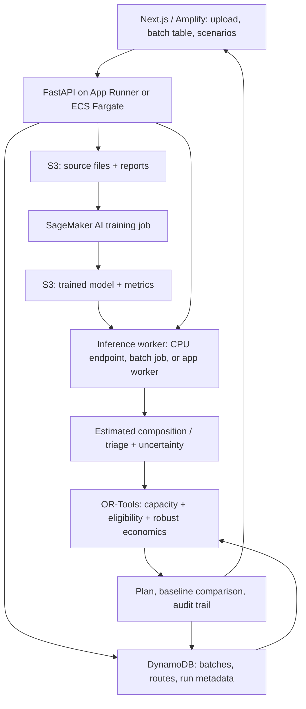

# YieldSense 2.0 — Detailed Technical Implementation Guide

**Project name:** YieldSense — Uncertainty-Aware E-Waste Recovery Route Optimization  
**Target:** 24–48-hour AWS-sponsored hackathon; extensible research prototype  
**Version/date:** v1.0 · October 2026  
**Stack:** Python, PyTorch, Amazon SageMaker AI, FastAPI, OR-Tools, Next.js, AWS S3/Lambda/Amplify  
**Main deliverable:** Working digital decision twin that estimates material composition *with explicit uncertainty* and selects the **highest-value feasible** treatment route rather than claiming to recover metals itself.

> **Read first — data limitation.** The most directly relevant **263.42 MB RGB particle-image + mass dataset** is flagged **restricted access** in its repository record. A separate **open raw industrial image release is very large (individual ZIPs ≈20–39 GB)**. The open **FutuRaM CSV** contains *collection-category-level composition*, not image-level labels. The open **XBAT+ RGB dataset** labels *whole WEEE/battery-containing devices*, not the masses of shredded particles. These sources must **not** be silently treated as interchangeable. This guide includes an honest, independently executable fallback.

---

## 0. Executive decision: what exactly to build?

### The concrete problem

A WEEE recycler receives material batches of uncertain composition. Routes such as mechanical separation, specialized PCB recovery, approved external recycling, and controlled residual treatment have different tariffs, yields, throughput constraints, and technical requirements. A visually impressive material detector does not answer whether sending the *entire batch* through a given route is economically wise, especially when the inferred composition could be wrong.

**Core research question:**

> Can **uncertainty-aware recovery-route assignment** increase risk-adjusted net recoverable value, while satisfying treatment capacity and safety constraints, compared with assigning batches by their most likely material class or by expected profit alone?

### MVP user journey

1. Operator creates a batch with a **weighbridge or scale weight (kg)**.
2. System obtains a composition estimate plus uncertainty: from a supported image/mass model **only if the corresponding real dataset is available**, or from a category-level prior plus operator-supplied observations.
3. User selects processing routes, processing costs, recovery yields, capacity limits, and sale prices (all attributed as actual quotes, source benchmarks, or **synthetic/demo assumptions**).
4. Optimizer computes a route assignment for several batches and reports **expected, worst-scenario, and baseline** net values.
5. User simulates a price collapse or route shutdown; the system re-optimizes and explains which capacity/compatibility constraints changed.
6. Dashboard exports a reproducible decision report with inputs, model version, assumptions, and risk disclosure.

### Out of scope for the 48-hour MVP

- Robot control, chemical extraction, metal purity assays, and actual physical yield testing.
- Identifying gold/cobalt concentration from ordinary RGB images.
- Automatically certifying legal or hazardous waste handling.
- Training particle-mass regression using unrelated whole-device photographs.
- Crediting carbon savings or regulatory compliance without auditable factors and review.

### Definition of success

**Minimum demonstration:** 10–30 lots, 3–5 synthetic processing routes, 3+ composition scenarios per lot, a reproducible optimized plan and two baselines, and at least one actual SageMaker AI training job or inference job that completes successfully. Financial outputs are scenario-derived until verified facility/market cost data are obtained.

---

## 1. What is known from research and what is not

### Source-grounded foundation

- Vogelgesang et al. (2025) already demonstrated RGB-based identification of **ferrous metals (FEM), non-ferrous metals (NFM), printed circuit boards (PCB), plastics (PLA)** and particle mass estimation in a pilot-scale sorting system. Their published experiment reported **4.94% mean class-wise relative composition error** on its validation mixtures. **Do not describe this as a YieldSense result or claim novelty for reproducing the pipeline.**
- The related TU Darmstadt repository describes three types of data: (1) material-labeled object images, (2) object images paired with physical particle masses, and (3) mixed samples with ground-truth composition. The processed ZIP record currently says **file access restricted**.
- A different TU Darmstadt record lists **open-access RAW image ZIPs** totaling well over 100 GB, but it is not automatically a usable replacement for paired particle **mass labels**. Inventory the ZIP structure and check the existence and rights of corresponding labels before planning regression.
- FutuRaM's open 8.4 MB WEEE composition CSV is useful for **category-level priors and scenario stress tests**, not for training visual particle detection.
- XBAT+ has open resized RGB and X-ray image sets for **whole-device WEEE and battery identification**. It can underpin a safety/triage classifier, but its label semantics are different from shredded material classification. Inspect its supplied metadata and class IDs before training.

### Main scientific/engineering novelty

The published particle-recognition study estimates material fractions. YieldSense instead uses a **distribution over plausible fractions** to make **capacity-constrained, economics-aware route choices**, tests regret relative to an oracle, and explicitly flags infeasibility or human-review requirements.

A realistic industry deployment would require site-specific measured input/output mass, costs, equipment specs, approved material categories, and safety sign-off. No public dataset above contains all these dimensions together.

---

## 2. Data acquisition and access gate (do this first)

| Dataset | URL | What it actually includes | Access / feasibility | Use in YieldSense |
|---|---|---|---|---|
| TU Darmstadt RGB-MFCO processed | https://tudatalib.ulb.tu-darmstadt.de/items/e05efd14-6421-43ba-a9e4-123c536e712a | Shredded WEEE images; particle mass and mixed-sample references | **Record says restricted**, 263.42 MB | **Track A** only after confirmed file access |
| TU Darmstadt RAW industrial images | https://tudatalib.ulb.tu-darmstadt.de/items/dbcba445-e534-49f2-bea2-4f9486f39af0 | RAW industrial camera images by material/size | Open listing; huge (individual ZIPs ≈20–39 GB) | Optional later; investigate annotation/weight pairing independently |
| FutuRaM WEEE consolidated composition | https://zenodo.org/records/17789750 | **Category-level** WEEE material composition CSV | Open; ~8.4 MB | **Guaranteed planning fallback**: priors/scenarios, subject to CSV inspection |
| XBAT+ 1.0 | https://zenodo.org/records/18022530 | **Whole WEEE device** RGB and X-ray images, battery-related labels | Open; resized RGB subsets ~6 MB + ~1.6 MB | **Track B** vision: device triage / battery risk classification |
| Original scientific paper | https://doi.org/10.1016/j.wasman.2025.114904 | Published detection + mass-regression method and evaluation | Open article | Baselines and reproducibility, **not your novelty** |
| India CPCB E-Waste EPR portal | https://www.eprewaste.cpcb.gov.in/ | E-Waste (Management) Rules and operator regulatory resources | Open portal | Compliance reference, not model-training data |
| India CPCB battery EPR portal | https://eprbattery.cpcb.gov.in/ | Battery Waste Management Rules and guidance | Open portal | Safety escalation and separately authorized handling |

### Access gate: 90-minute decision

- [ ] Try to download/inspect the 263 MB dataset from its official page; check both repository access indicator and actual ability to read **paired masses**.
- [ ] If data are obtainable, calculate counts by material and particle size and inspect the real train/test structure. Select **Track A**.
- [ ] Otherwise stop immediately; use **Track B** with XBAT+ device imagery and FutuRaM composition data. Do not waste hackathon time crawling large raw industrial ZIPs.
- [ ] Verify dataset licenses, permitted reuse, provenance, checksums, format, and possible train/test leakage. Cite each dataset on final slides.
- [ ] Record the attempted access decision in `docs/data_provenance.md`.

**Automatable listing via Zenodo API:**

```bash
# Lists metadata and file URLs/sizes from the official record; no invented CSV column names.
python - <<'PY'
import requests
for rec in (17789750, 18022530):
    data = requests.get(f"https://zenodo.org/api/records/{rec}", timeout=40).json()
    print("record", rec)
    for f in data.get("files", []):
        print(f.get("key"), f.get("size"), f.get("checksum"))
PY
```

Download the specific verified files via the official record's **Files → Download** links; do not assume all data can be fetched without credentials. If download scripts are needed, use `files[*].links.self` returned by the record API.

### FutuRaM CSV inspection (before modeling)

```python
# scripts/inspect_futuram.py
from pathlib import Path
import pandas as pd

p = Path("data/raw/futuram_composition.csv")
assert p.exists(), f"Download the real CSV first: {p}"
# Delimiter may differ; let pandas sniff it. Inspect schema before mapping units.
df = pd.read_csv(p, sep=None, engine="python")
print("shape:", df.shape)
print("columns:", list(df.columns))
print(df.head(5).to_string(index=False))
print("null counts:\n", df.isna().sum().sort_values(ascending=False).head(20))
```

**Data contract task:** Inspect column names, category taxonomy, mass/fraction units, origin year and region, weighting scheme, and whether records are observations, estimates, or derived aggregates. Write a separate `scripts/transform_futuram.py` **only after this inspection**. Never arbitrarily interpret percentage points as kilograms or assume PCB fraction appears directly.

---

## 3. Two feasible end-to-end tracks

### Track A — Shredded WEEE particle characterization (conditional)

Choose only if you actually obtain labeled particle images **and paired masses**.

```
RGB shredded-particle images
    -> material identification (FEM/NFM/PCB/PLA)
    -> measured-image features + particle mass regressor
    -> sum estimated per-class particle masses per batch
    -> bootstrap/calibrated composition scenarios
    -> route optimizer -> plan + uncertainty bands
```

**Models:**

1. Material identification: pretrained lightweight ResNet18/EfficientNet (single-particle crops) or YOLO detector for scene-level images with object annotations. Use the label format the dataset *actually* provides.
2. Mass regression: gradient boosting/RandomForest/KNN baseline on region features (area, bounding-box dimensions, shape, texture, color, size-bin, predicted class), then compare with neural regression if time remains.
3. Composition: estimated mass per material divided by estimated batch mass. Compare against measured fraction totals on **held-out mixed batches**. Do not split images from the same acquisition group across train/test.
4. Uncertainty: fit residual error distributions on validation batches, preferably **group-bootstrap at batch level**, not by independently perturbing each particle.

**Important calibration caveat:** A visual estimated weight is a model output, not a verified scale reading. For decisions, reconcile predicted component masses to **actual weighbridge batch mass** when that measurement is available; report any discrepancy.

### Track B — Open-data-safe fallback (recommended if Track A access fails)

```
XBAT+ resized whole-device RGB images
    -> SageMaker AI device class classifier
    -> battery-risk / human-review triage [only if labels support it]
    -> operator enters scale weight + WEEE collection category
    -> FutuRaM category-based composition prior, if matching categories exist
    -> uncertainty scenarios / manual fractions if no valid match
    -> route optimizer -> plan + explanations
```

**Be explicit:** Whole-device RGB classification does **not** establish shredded ferrous/NFM/PCB/plastic mass ratios. Treat device recognition as **triage and metadata**, and composition as a **separate prior/inventory estimate**. A photograph alone never proves battery chemistry, contamination, or precious-metal concentration. Uncertain battery presence triggers **human inspection and safe quarantine**, not an automatic hazard clearance.

**Priority for 48 hours:** Ship Track B from day one unless you have already downloaded and indexed Track A's complete data and labels before the event. Track A can be used later as an upgrade.

---

## 4. Architecture (AWS-first, practical)



### Deployment choice and rationale

| Layer | Hackathon choice | Why |
|---|---|---|
| Web frontend | Next.js 15 + Tailwind + Recharts on **AWS Amplify** | Polished dashboard and AWS branding |
| API + optimizer | **FastAPI** on App Runner or ECS Fargate; locally via `uvicorn` | Avoid Lambda's native OR-Tools packaging/time-limit complications |
| ML training | **Amazon SageMaker AI** training job with CPU or small GPU (quotas permitting) | Genuine AWS ML usage and reproducible model artifact |
| ML inference | Initially packaged CPU inference loaded in API worker; optional SageMaker Batch Transform/async endpoint | Avoid a 24/7 GPU endpoint; do not claim API-local inference is SageMaker hosting |
| Storage | S3 for datasets/artifacts/reports | Versioned data provenance and outputs |
| Metadata | DynamoDB (optional MVP: local SQLite then migrate) | Run and batch state; simplest integration first |
| Monitoring | CloudWatch logs | Error tracking; include run IDs and model versions |
| Authentication | Optional Cognito | Don't block core demo on auth |

**Must-have AWS proof:** Save the SageMaker training-job ARN, instance type, timestamps, metrics, and `model.tar.gz` S3 URI. On the demo, show at least one inference result genuinely produced by that trained model. Using SageMaker for training **does not require** using a SageMaker hosted endpoint.

### Alternative production inference

- **Batch Transform:** best for nightly/queued bulk batch estimates; no idle endpoint.
- **Asynchronous Inference:** large inputs or slow predictions, with queueing and possible scale-to-zero when configured appropriately.
- **Serverless Inference:** intermittent, compatible smaller CPU models; review payload/memory limitations.
- **Real-time endpoint:** only if live continuous inference justifies idle cost.

Refer to the AWS official SageMaker inference options documentation before selecting a mode: https://docs.aws.amazon.com/sagemaker/latest/dg/deploy-model-options.html

---

## 5. Repository layout

```text
yieldsense/
├── README.md
├── .env.example
├── .gitignore
├── docker-compose.yml
├── docs/
│   ├── data_provenance.md
│   ├── assumptions.md
│   ├── methodology.md
│   └── experiment_results.md
├── data/
│   ├── raw/                  # gitignored; source datasets
│   ├── interim/
│   ├── processed/
│   └── synthetic/
├── ml/
│   ├── requirements.txt
│   ├── train.py              # Track B: device image classification
│   ├── inference.py
│   ├── evaluate.py
│   ├── split_dataset.py
│   └── track_a/              # only with real particle/mass labels
│       ├── features.py
│       ├── mass_regression.py
│       └── composition_eval.py
├── scripts/
│   ├── inspect_futuram.py
│   ├── transform_futuram.py
│   ├── make_synthetic.py
│   └── launch_sagemaker.py
├── backend/
│   ├── app/
│   │   ├── main.py
│   │   ├── schemas.py
│   │   ├── optimizer.py
│   │   ├── scenarios.py
│   │   ├── policy.py
│   │   ├── model_adapter.py
│   │   └── storage.py
│   ├── tests/
│   │   ├── test_optimizer.py
│   │   ├── test_safety.py
│   │   ├── test_mass_balance.py
│   │   └── test_api.py
│   ├── requirements.txt
│   └── Dockerfile
├── frontend/
│   ├── app/
│   ├── components/
│   └── lib/api.ts
└── infra/
    ├── iam-policy-example.json
    └── deployment-notes.md
```

Create this structure first. The optimization engine and dataset ingestion can be built independently in parallel.

---

## 6. Data contracts and database fields

All economic computations must use **one currency** (INR for the demo) and **one mass unit** (kg). This prevents easy but severe errors.

### Batch object

```json
{
  "batch_id": "BATCH-0042",
  "origin": "Facility-A",
  "weee_category": "CATEGORY_FROM_CONFIRMED_SOURCE_TAXONOMY",
  "mass_kg": 450.0,
  "intake_at": "2026-10-09T10:00:00+05:30",
  "input_mode": "collection_category_prior",
  "model_version": "xbat-classifier-v1",
  "composition_source": "futuram_prior_or_operator_sample",
  "composition_mean": {"FEM": 0.30, "NFM": 0.18, "PCB": 0.12, "PLA": 0.40},
  "composition_scenarios": [
    {"FEM": 0.30, "NFM": 0.18, "PCB": 0.12, "PLA": 0.40},
    {"FEM": 0.24, "NFM": 0.15, "PCB": 0.08, "PLA": 0.53},
    {"FEM": 0.34, "NFM": 0.20, "PCB": 0.14, "PLA": 0.32}
  ],
  "battery_status": "unknown",
  "human_review_required": true
}
```

**All fractions and scenario data above are synthetic examples** and should not be attributed to FutuRaM. The four particle classes are an illustrative simplified representation that may not cover an entire real device stream; real batch composition must also support **other/unknown** material if necessary so total mass remains accounted for.

### Route object

```json
{
  "route_id": "ROUTE-PCB",
  "name": "Approved specialized recovery",
  "accepts_categories": ["CATEGORY_FROM_CONFIRMED_SOURCE_TAXONOMY"],
  "allowed_battery_states": ["confirmed_absent"],
  "authorized": true,
  "capacity_kg": 1000,
  "processing_cost_inr_per_kg": 17.5,
  "transport_inr_per_batch": 850,
  "material_recovery_fraction": {"FEM": 0.3, "NFM": 0.7, "PCB": 0.8, "PLA": 0.1},
  "sale_price_inr_per_kg_recovered": {"FEM": 10, "NFM": 60, "PCB": 80, "PLA": 3}
}
```

Again: **synthetic example pricing and recoveries**, not market facts. Treat PCB as a *material class* whose contracted recovered-value payment may depend heavily on downstream assays and grade. Do not claim it represents the price of gold contained in PCB.

### Database tables / DynamoDB collections

- `batches`: batch ID, source, measured mass, model version, category, manifest/owner, review state.
- `model_outputs`: batch ID, predictions, confidence, abstention decision, evaluation provenance.
- `composition_estimates`: mean, scenarios, source (`measured`, `inferred`, `prior`, `synthetic`), timestamp.
- `routes`: processor/operator, categories accepted, authorization verified flag, throughput, tariffs and recovery yield source.
- `opt_runs`: run ID, objective, seed, baseline values, robustness setting, solver status, wall-time.
- `allocations`: run ID, batch ID, route ID, expected/worst profit and constraints.
- `evidence`: documents/licenses/price quotes and audit source references (optional).

---

## 7. Uncertainty and physical mass balance

### Composition estimate

For lot \(i\), define mass \(M_i\) and material fractions \(p_{ik}\), where:

\[
 p_{ik} \ge 0, \qquad \sum_k p_{ik}=1
\]

For a real particle-mass model, estimate:

\[
\hat p_{ik}=\frac{\sum_{j\in i}\hat m_j\,\mathbb{1}(\hat c_j=k)}{\sum_{j\in i}\hat m_j}
\]

Require all observed particles to be counted or explicitly labeled `unknown`; check that inferred total mass is consistent with scale mass. Hard-to-see particle occlusion means image-derived fractions may have significant bias.

### Track B uncertainty (without per-particle truth)

1. Select the nearest **valid** category-level composition prior from the verified FutuRaM schema, or require operator-entered composition.
2. Treat the prior as an *assumption*, not an accurate physical measurement of the received batch.
3. Generate multiple composition scenarios constrained to sum to one. Use a Dirichlet distribution around \(\boldsymbol{p}\) only as a **sensitivity tool**; the concentration parameter represents assumed variability, not empirically calibrated uncertainty.
4. Provide a slider for `concentration` or `uncertainty_level`; label its statistical interpretation transparently.
5. Require human confirmation for material quality or battery presence when model confidence is low or when image labels cannot establish safety.

Minimal scenario generator:

```python
# backend/app/scenarios.py
import numpy as np

CLASSES = ("FEM", "NFM", "PCB", "PLA")

def generate_scenarios(mean: dict[str, float], n: int = 10,
                       concentration: float = 50.0, seed: int = 42):
    vec = np.array([float(mean[c]) for c in CLASSES], dtype=float)
    if np.any(vec < 0) or not np.isclose(vec.sum(), 1.0, atol=1e-5):
        raise ValueError("Composition must be nonnegative and sum to 1")
    # Small epsilon only for numerical sampling; retain mean scenario as input.
    alpha = np.maximum(vec, 1e-6) * concentration
    rng = np.random.default_rng(seed)
    draws = rng.dirichlet(alpha, size=n)
    return [mean] + [dict(zip(CLASSES, map(float, row))) for row in draws]
```

**For a stronger post-hackathon model:** Estimate empirical composition error from held-out labeled mixed batches, use conformal intervals or group bootstrap, and test whether the proposed bands achieve nominal coverage. Do not describe the Dirichlet slider as calibrated until real validation demonstrates that it is.

---

## 8. Mathematical optimization model

Use a **mixed-integer linear program (MILP)**, not an LLM, for actual route decisions. LLMs may only explain outputs.

### Sets and decisions

- \(i \in I\): weighed waste batches.
- \(r \in R\): eligible processing routes or authorized handling paths.
- \(k \in K\): material classes.
- \(s \in S\): plausible composition scenarios.
- \(x_{ir} \in \{0,1\}\): 1 if lot \(i\) goes to route \(r\).

### Route economics

Let:

- \(M_i\): batch mass kg.
- \(p_{iks}\): fraction of material \(k\) in lot \(i\), scenario \(s\).
- \(y_{rk}\): **contracted/assumed recoverable fraction** of material \(k\) at route \(r\).
- \(v_{rk}\): revenue INR per recovered kg of material \(k\).
- \(c_r\): processing cost INR/kg of full incoming batch.
- \(t_{ir}\): transport charge INR per batch.
- \(C_r\): route's available incoming capacity kg.

For each feasible assignment and scenario:

\[
 P_{irs}=M_i\left(\sum_k p_{iks} y_{rk} v_{rk}-c_r\right)-t_{ir}
\]

This is **net modeled contribution**, not guaranteed realized cash profit. It ignores overhead unless overhead is explicitly included in the cost model. Costs for residual disposal, storage, energy, and penalties must be included as additional terms when relevant and measurable.

### Robust optimization objective

Maximize guaranteed modeled profit over supplied scenarios:

\[
\max_{x,z} z \quad \text{such that}\quad
z \le \sum_{i,r}P_{irs}x_{ir}\quad\forall s
\]

Constraints:

\[
\sum_r x_{ir}=1 \quad\forall i
\]

\[
\sum_i M_i x_{ir}\le C_r \quad\forall r
\]

\[
x_{ir}=0\quad\text{if not legally/technically eligible}
\]

The candidate list must contain a **valid fallback** such as approved hold/quarantine with its real storage limits; don't use ordinary landfill or unauthorized treatment merely to guarantee a mathematical solution. If no safe/authorized plan exists, return **INFEASIBLE + operator escalation**.

**Interpretation:** This robust objective maximizes the minimum profit over *the supplied scenarios*, not over every physically imaginable composition. A larger uncertainty set typically reduces the conservative profit estimate.

### Alternative objectives for the presentation

- `EXPECTED`: maximize mean-scenario total value (usually more aggressive).
- `ROBUST`: maximize minimum value across scenarios (more conservative).
- `RISK_WEIGHTED`: maximize `mean_profit − lambda × downside_risk` (advanced; implement with linearized downside or scenario-CVaR).

**For the MVP implement EXPECTED and ROBUST**. Do not add CVaR until the core plan is correct and tested.

### Executable optimizer core (copy into `backend/app/optimizer.py`)

This example assumes one route **per unsplit batch**, batch-level flat transport costs, and complete compositions for the 4 demonstration classes. All money is INR. It accepts actual numeric inputs or labeled scenario assumptions.

```python
from dataclasses import dataclass
from typing import Dict, List
from ortools.linear_solver import pywraplp

CLASSES = ("FEM", "NFM", "PCB", "PLA")

@dataclass(frozen=True)
class Lot:
    lot_id: str
    mass_kg: float
    scenarios: List[Dict[str, float]]
    category: str
    battery_status: str = "unknown"

@dataclass(frozen=True)
class Route:
    route_id: str
    capacity_kg: float
    cost_per_kg: float
    transport_per_lot: float
    recovery: Dict[str, float]
    price: Dict[str, float]
    accepted_categories: frozenset[str]
    allowed_battery_states: frozenset[str]
    authorized: bool


def eligible(lot: Lot, route: Route) -> bool:
    return (
        route.authorized
        and lot.category in route.accepted_categories
        and lot.battery_status in route.allowed_battery_states
    )


def profit(lot: Lot, route: Route, scenario: Dict[str, float]) -> float:
    recovered_revenue_per_kg = sum(
        scenario[c] * route.recovery[c] * route.price[c] for c in CLASSES
    )
    return lot.mass_kg * (recovered_revenue_per_kg - route.cost_per_kg) \
        - route.transport_per_lot


def validate(lots: List[Lot], routes: List[Route]) -> int:
    if not lots or not routes:
        raise ValueError("Provide at least one lot and one route")
    n = len(lots[0].scenarios)
    if n < 1 or any(len(l.scenarios) != n for l in lots):
        raise ValueError("Each lot must have the same nonzero number of scenarios")
    for lot in lots:
        if lot.mass_kg <= 0:
            raise ValueError("Each lot must have positive measured mass")
        for s in lot.scenarios:
            if set(s) != set(CLASSES) or any(v < 0 for v in s.values()):
                raise ValueError("Invalid material fractions")
            if abs(sum(s.values()) - 1.0) > 1e-6:
                raise ValueError("Fractions must sum to 1")
    for route in routes:
        if route.capacity_kg < 0 or route.cost_per_kg < 0 or route.transport_per_lot < 0:
            raise ValueError("Capacity/cost must be nonnegative")
        if set(route.recovery) != set(CLASSES) or set(route.price) != set(CLASSES):
            raise ValueError("Route material maps incomplete")
        if any(not 0 <= v <= 1 for v in route.recovery.values()):
            raise ValueError("Recovery yields must be fractions in [0,1]")
        if any(v < 0 for v in route.price.values()):
            raise ValueError("Recovered material prices must be nonnegative")
    return n


def solve(lots: List[Lot], routes: List[Route],
          objective: str = "ROBUST", time_limit_ms: int = 5000) -> dict:
    n_scenarios = validate(lots, routes)
    if objective not in ("ROBUST", "EXPECTED"):
        raise ValueError("objective must be ROBUST or EXPECTED")
    solver = pywraplp.Solver.CreateSolver("CBC")
    if solver is None:
        raise RuntimeError("OR-Tools CBC backend unavailable")
    solver.SetTimeLimit(time_limit_ms)

    # Only generate legally and technically eligible choices.
    x = {}
    for i, lot in enumerate(lots):
        for r, route in enumerate(routes):
            if eligible(lot, route):
                x[i, r] = solver.BoolVar(f"x_{i}_{r}")

    # Each batch must have one eligible destination.
    for i in range(len(lots)):
        choices = [x[i, r] for r in range(len(routes)) if (i, r) in x]
        if not choices:
            return {"status": "INFEASIBLE", "reason": f"No eligible route for {lots[i].lot_id}"}
        solver.Add(sum(choices) == 1)

    # Route throughput limits; routing the whole lot consumes its full input mass.
    for r, route in enumerate(routes):
        solver.Add(sum(lots[i].mass_kg * x[i, r]
                       for i in range(len(lots)) if (i, r) in x) <= route.capacity_kg)

    scenario_profits = []
    for s in range(n_scenarios):
        scenario_profits.append(sum(
            profit(lots[i], routes[r], lots[i].scenarios[s]) * var
            for (i, r), var in x.items()
        ))

    if objective == "ROBUST":
        guaranteed = solver.NumVar(-1e12, 1e12, "guaranteed_profit")
        for p in scenario_profits:
            solver.Add(guaranteed <= p)
        solver.Maximize(guaranteed)
    else:
        solver.Maximize(sum(scenario_profits) / n_scenarios)

    result = solver.Solve()
    if result not in (pywraplp.Solver.OPTIMAL, pywraplp.Solver.FEASIBLE):
        return {"status": "INFEASIBLE_OR_TIMEOUT", "solver_code": int(result)}
    assignments = [
        {"lot_id": lots[i].lot_id, "route_id": routes[r].route_id}
        for (i, r), var in x.items() if var.solution_value() > 0.5
    ]
    totals = [sum(
        profit(lots[i], routes[r], lots[i].scenarios[s])
        for (i, r), var in x.items() if var.solution_value() > 0.5
    ) for s in range(n_scenarios)]
    return {
        "status": "OPTIMAL" if result == pywraplp.Solver.OPTIMAL else "FEASIBLE",
        "objective": objective,
        "assignments": assignments,
        "expected_profit_inr": sum(totals) / len(totals),
        "worst_scenario_profit_inr": min(totals),
        "scenario_profits_inr": totals,
        "wall_time_ms": solver.wall_time(),
    }
```

**Why this is useful:** When route capacity decreases or recovery prices change, solving the same model produces a different justified assignment. The method is small enough to run during a live demo and rigorous enough to benchmark.

### Optimizer limitations (put these on the dashboard)

- It assumes unsplit batches; real facilities often split streams after preprocessing.
- Cost is linear in weight plus a flat trip charge; real pricing can include minimum loads and nonlinear tariffs.
- `authorized=True` means manually verified configuration, not a legal conclusion made by the algorithm.
- Price/yield inputs must show `source: quote | measured | literature | synthetic`.
- A scenario set generated from unvalidated priors gives only **scenario-robustness**, not calibrated real-world protection.
- Emissions and water/electricity usage are excluded until credible lifecycle coefficients exist.

---

## 9. Model training in SageMaker AI

### Track B model: whole-device WEEE class recognition

Start with XBAT+ **resized RGB train/test archives**, not the multi-gigabyte raw X-ray files. The dataset page identifies original per-class train/test splits; **preserve those splits** for evaluation. First inspect how its annotations encode labels: they may require metadata parsing rather than standard `ImageFolder` layout.

The job is to recognize an intact **device category** (and battery risk only to the extent that the available label actually supports it), not shredded material composition.

#### 9.1 Data preprocessing requirements

- Create a CSV manifest: `image_path,device_id,label,split` from official metadata.
- Match official class IDs to human-readable class labels from the dataset's annotation description.
- Split by **device ID** if creating any new validation partition so near-duplicate views of the same device cannot leak between training and validation.
- Avoid class claims such as “battery chemistry detected” when your chosen RGB labels only give device category.
- For evaluation report confusion matrix and **macro F1** due to potentially imbalanced classes.

#### 9.2 Local baseline before spending AWS budget

```bash
python -m venv .venv
source .venv/bin/activate  # Windows PowerShell: .venv\Scripts\Activate.ps1
python -m pip install --upgrade pip
pip install torch torchvision pillow scikit-learn pandas numpy boto3 sagemaker
```

Model configuration:

- `torchvision.models.resnet18(weights=ResNet18_Weights.DEFAULT)` if the environment can download pretrained weights.
- Replace the final classification layer for the **actual supported XBAT+ RGB classes**.
- Initially freeze the backbone, train the final layer for 3–5 epochs, then optionally unfreeze the last block.
- Use balanced sampling or weighted loss if class imbalance exists; augment mildly (resize/crop/color jitter), avoiding transformations that hide crucial battery cues.
- Save class order, model weights, normalization config, data manifest hash, and metrics.

#### 9.3 Minimal training script pattern

```python
# ml/train.py — starter pattern; expects preprocessing to create ImageFolder directories.
import json
import os
from pathlib import Path
import torch
from torch import nn
from torch.utils.data import DataLoader
from torchvision import datasets, models, transforms

train_dir = Path(os.environ.get("SM_CHANNEL_TRAIN", "data/processed/train"))
val_dir = Path(os.environ.get("SM_CHANNEL_VALIDATION", "data/processed/validation"))
model_dir = Path(os.environ.get("SM_MODEL_DIR", "artifacts"))
model_dir.mkdir(parents=True, exist_ok=True)

preprocess = transforms.Compose([
    transforms.Resize((224, 224)),
    transforms.ToTensor(),
    transforms.Normalize([0.485, 0.456, 0.406], [0.229, 0.224, 0.225]),
])
train_ds = datasets.ImageFolder(train_dir, transform=preprocess)
val_ds = datasets.ImageFolder(val_dir, transform=preprocess)
assert train_ds.classes == val_ds.classes, "Class order mismatch"
assert len(train_ds) > 0 and len(val_ds) > 0

train_loader = DataLoader(train_ds, batch_size=16, shuffle=True)
val_loader = DataLoader(val_ds, batch_size=32)
weights = models.ResNet18_Weights.DEFAULT
model = models.resnet18(weights=weights)
for p in model.parameters():
    p.requires_grad = False
model.fc = nn.Linear(model.fc.in_features, len(train_ds.classes))

device = torch.device("cuda" if torch.cuda.is_available() else "cpu")
model.to(device)
optim = torch.optim.AdamW(model.fc.parameters(), lr=1e-3)
loss_fn = nn.CrossEntropyLoss()
for epoch in range(5):
    model.train()
    for images, labels in train_loader:
        images, labels = images.to(device), labels.to(device)
        optim.zero_grad()
        loss = loss_fn(model(images), labels)
        loss.backward()
        optim.step()
    model.eval()
    correct, total = 0, 0
    with torch.no_grad():
        for images, labels in val_loader:
            images, labels = images.to(device), labels.to(device)
            pred = model(images).argmax(1)
            correct += (pred == labels).sum().item()
            total += len(labels)
    print(json.dumps({"epoch": epoch + 1, "validation_accuracy": correct / total}))

torch.save(model.state_dict(), model_dir / "model.pth")
(model_dir / "labels.json").write_text(json.dumps(train_ds.classes))
```

**This is a runnable starter once properly transformed dataset folders exist**, not a replacement for the full evaluation notebook. If SageMaker training has no outbound internet, pretrained weight download may fail: upload/copy permitted weight files ahead of time or train the small final head against a locally available model. Record this dependency.

#### 9.4 Launch the SageMaker training job

```python
# scripts/launch_sagemaker.py — SDK-style starter; verify the versions your region supports.
import os
import sagemaker
from sagemaker.pytorch import PyTorch

session = sagemaker.Session()
role = os.environ["SAGEMAKER_ROLE_ARN"]
bucket = os.environ["YIELDSENSE_BUCKET"]
train_s3 = f"s3://{bucket}/datasets/xbat/train/"
val_s3 = f"s3://{bucket}/datasets/xbat/validation/"

estimator = PyTorch(
    entry_point="train.py",
    source_dir="ml",
    role=role,
    framework_version=os.environ["SM_PYTORCH_VERSION"],  # choose supported version
    py_version=os.environ["SM_PY_VERSION"],  # e.g. py310/py311 where supported
    instance_count=1,
    instance_type=os.environ.get("SM_TRAIN_INSTANCE", "ml.m5.xlarge"),
    volume_size=15,
    max_run=1800,
    output_path=f"s3://{bucket}/model-artifacts/",
    base_job_name="yieldsense-xbat",
)
estimator.fit({"train": train_s3, "validation": val_s3}, wait=True, logs=True)
print("Training job:", estimator.latest_training_job.name)
print("Artifact:", estimator.model_data)
```

**SDK version note:** The example uses the SageMaker Python SDK **v2-style `PyTorch` estimator**. SDK v3 favors `ModelTrainer` and has a different API: pin compatible SDK v2 for this snippet or port it using the official migration guide (https://github.com/aws/sagemaker-python-sdk/blob/master/migration.md).

**Prerequisites:** `aws configure` or IAM role credentials; `SAGEMAKER_ROLE_ARN` valid in your account; training quota/instance supported in the AWS region; bucket permission for SageMaker; chosen framework version valid for the current SDK/container; processed `ImageFolder` trees uploaded under correct S3 prefixes. Treat the environment variables as real configuration tasks, not literal values. Sample code uses the SageMaker Python SDK estimator interface; adapt imports for the installed SDK version if necessary.

#### 9.5 Track A particle mass regression (only if paired measurements exist)

1. Construct a row per particle: material class, size bin, extracted shape/texture/color features, **measured mass** and acquisition group ID.
2. Split by acquisition group/batch. Never randomly split near-identical video frames or particles from the same capture group across train/test.
3. Evaluate dummy `median mass per material × size bin` and a KNN/RandomForest regression baseline before deeper ML.
4. Report MAE/RMSE by class, and **mixed-batch composition error**, not only particle-level weight error.
5. Reconcile estimated total to measured batch weight with a documented normalization technique; evaluate impact on economic assignments.
6. Capture epistemic/measurement uncertainty using held-out batch residuals; avoid arbitrary ±5% error claims.
7. Train regression on SageMaker after local validation; attach artifact hash and data version to every optimization run.

---

## 10. Backend APIs and model adapter

### Endpoint contract

| Method | Route | Request | Response |
|---|---|---|---|
| `GET` | `/health` | — | service status, git SHA, model loaded? |
| `POST` | `/v1/batches` | metadata + known scale mass + category | batch ID and validation flags |
| `POST` | `/v1/predict-device` | uploaded RGB image or S3 object key | device probabilities, model version, abstain/review flag |
| `POST` | `/v1/composition` | batch ID + permitted prior/measurement source | fractions, scenarios, assumptions |
| `GET` | `/v1/routes` | optional filters | eligible routes, costs, capacity and price source |
| `POST` | `/v1/optimize` | batch IDs, route IDs, objective and scenario ID | assignments, objective values, solver status |
| `POST` | `/v1/simulate` | change in price, route shutdown, or capacity | reoptimized decision + delta vs baseline |
| `GET` | `/v1/reports/{run_id}` | — | signed/exportable JSON report, simulation disclosures |

### FastAPI starter

```python
# backend/app/main.py
from fastapi import FastAPI, HTTPException
from pydantic import BaseModel, Field
from typing import Dict, List
from .optimizer import Lot, Route, solve

app = FastAPI(title="YieldSense Optimization API", version="0.1.0")

class LotInput(BaseModel):
    lot_id: str
    mass_kg: float = Field(gt=0)
    scenarios: List[Dict[str, float]]
    category: str
    battery_status: str = "unknown"

class RouteInput(BaseModel):
    route_id: str
    capacity_kg: float = Field(ge=0)
    cost_per_kg: float = Field(ge=0)
    transport_per_lot: float = Field(ge=0)
    recovery: Dict[str, float]
    price: Dict[str, float]
    accepted_categories: List[str]
    allowed_battery_states: List[str]
    authorized: bool

class OptimizeInput(BaseModel):
    lots: List[LotInput]
    routes: List[RouteInput]
    objective: str = "ROBUST"

@app.get("/health")
def health():
    return {"ok": True, "service": "yieldsense", "optimizer": "ortools-cbc"}

@app.post("/v1/optimize")
def optimize(payload: OptimizeInput):
    try:
        lots = [Lot(**v.model_dump()) for v in payload.lots]
        routes = [Route(**{
            **v.model_dump(),
            "accepted_categories": frozenset(v.accepted_categories),
            "allowed_battery_states": frozenset(v.allowed_battery_states),
        }) for v in payload.routes]
        return solve(lots, routes, objective=payload.objective)
    except (ValueError, RuntimeError) as exc:
        raise HTTPException(status_code=422, detail=str(exc))
```

### Local backend dependencies

```text
# backend/requirements.txt
fastapi>=0.115,<1
uvicorn[standard]>=0.30,<1
pydantic>=2.7,<3
numpy>=1.26,<3
ortools>=9.10,<10
pytest>=8,<10
httpx>=0.27,<1
```

Run:

```bash
cd backend
python -m venv .venv
source .venv/bin/activate
pip install -r requirements.txt
uvicorn app.main:app --host 0.0.0.0 --port 8000 --reload
# Open http://localhost:8000/docs
```

**Safety note:** Backend must enforce eligibility, authorization and review status itself. Frontend filters are not sufficient. Never issue “ready for processing” if review required or a legally controlled stream has not been manually cleared.

---

## 11. Baselines, evaluation and statistical design

### Baselines (implement all three)

1. **FIXED ROUTE:** All compatible batches assigned to a preconfigured existing processor, subject to capacity; report violations if route would be overloaded.
2. **MEAN-GREEDY:** Sort batches by estimated value or mass; assign each to best route using **mean fractions only** until capacity fills.
3. **EXPECTED MILP:** Globally optimize **mean** modeled net value with exact constraints.
4. **YIELDSENSE ROBUST MILP (primary):** Globally optimize **worst scenario** net value with same constraints.

### Evaluation metrics

| Dimension | Metric | How to compute | Notes |
|---|---|---|---|
| Economic | Modeled net value INR/batch | modeled revenue − modeled operating cost | Source or label every cost |
| Economic | Improvement over baseline % | `(new - baseline)/abs(baseline) × 100` when baseline != 0 | If baseline zero, show absolute difference only |
| Risk | Worst-scenario value | min over common evaluation scenarios | Avoid comparing under different scenario sets |
| Risk | Decision regret | oracle with realized composition − chosen policy's realized value | Oracle assumes information not available to policy |
| Safety | Invalid-route assignments | count technical/legal violations | **Target: zero** for accepted solution |
| Capacity | Throughput exceedances | max allocated kg − allowed kg | Target: zero |
| Compute | Solver wall-time | milliseconds | Report p50/p95 across seeded cases |
| Vision (Track B) | Macro F1 + confusion matrix | held-out **device-level** test | Not a material composition result |
| Composition (Track A only) | Per-class mass-share MAE | predicted vs measured mixed-batch shares | Use actual mass ground truth |
| Uncertainty | Coverage | fraction of true compositions inside validated region | **Only** if actual held-out ground truth exists |

### Experimental protocol

1. Fix a master seed and publish `data/synthetic/scenarios.json` and economic parameters.
2. Evaluate 20, 50, 100 batches × 3, 5, 10 routes × low/medium/high uncertainty.
3. Simulate processing outages, price drops, and differing transport costs; use **identical scenarios and route permissions** for every algorithm.
4. Separate `calibration scenarios` (used by optimizer) and `evaluation scenarios` (held out) to prevent optimizing on test outcomes.
5. Compute confidence intervals across **scenario replications**, not across duplicated rows within one experiment.
6. Record solver status (`OPTIMAL` vs `FEASIBLE` vs `INFEASIBLE`) and fail tests if a result violates constraints.
7. Present costs as simulated until actual quotes are available, even if detector data are real.

### Tests to write before frontend

```python
# backend/tests/test_optimizer.py (partial examples)
from app.optimizer import Lot, Route, solve

SCENE = {"FEM": 0.4, "NFM": 0.2, "PCB": 0.1, "PLA": 0.3}

def route(name, cap):
    return Route(
        name, cap, 1.0, 0.0,
        {c: 1.0 for c in SCENE},
        {c: (5.0 if name == "good" else 3.0) for c in SCENE},
        frozenset({"standard"}), frozenset({"confirmed_absent"}), True,
    )

def test_prefers_high_recovery_route():
    lot = Lot("L1", 10.0, [SCENE], "standard", "confirmed_absent")
    out = solve([lot], [route("good", 10), route("other", 10)])
    assert out["status"] == "OPTIMAL"
    assert out["assignments"][0]["route_id"] == "good"

def test_fails_closed_for_unknown_battery():
    lot = Lot("L1", 10.0, [SCENE], "standard", "unknown")
    out = solve([lot], [route("good", 10)])
    assert out["status"] == "INFEASIBLE"

def test_capacity_is_enforced():
    lots = [Lot(f"L{i}", 10.0, [SCENE], "standard", "confirmed_absent")
            for i in range(2)]
    out = solve(lots, [route("good", 10), route("other", 10)])
    assert out["status"] == "OPTIMAL"
    assert len(out["assignments"]) == 2
    assert {a["route_id"] for a in out["assignments"]} == {"good", "other"}
```

Add edge cases: capacity=0, no authorized route, wrong sum fractions, negative price, null values, mixed battery states, identical tie, all options negative value, solver timeout, price outage. **Negative net value is allowed** if controlled handling is legally mandatory; an optimizer must not bypass required treatment to report profit.

---

## 12. Frontend UX that wins the demo

### Main page (four panels)

1. **Batch Intake:** photo preview/device classification (Track B), measured mass, collection category, confidence, data provenance.
2. **Estimated Composition:** 100% stacked bar with source tag (`measured`, `prior`, or `synthetic`) and uncertainty range; do not display pseudo-precision.
3. **Recovery Routes:** price per recovered kg, yield, processing fee, transport charge, capacity; human verified authorization.
4. **Optimizer Output:** baseline vs expected MILP vs robust MILP; assignment table; constraints; confidence/risk narrative.

### Live controls

- `Non-ferrous recovery price`: slider ±30% (synthetic scenario).
- `Processing route A capacity`: 100% → 0% (shutdown).
- `Composition uncertainty`: low → high (assumed scenario spread).
- `Optimization policy`: mean-greedy / expected MILP / robust MILP.
- `Battery status`: `unknown / suspect / confirmed_absent / confirmed_present` with mandatory human-review gating.

### Live demo narrative (90 seconds)

1. **Problem:** "Two e-waste batches look similar, but our material mix and downstream economics are uncertain."
2. **AI:** Upload a *whole-device* XBAT+ demo image; show SageMaker-trained classifier confidence. Explicitly explain this does not weigh shredded particles.
3. **Inputs:** Enter measured batch weight and select composition prior / controlled scenario.
4. **Decision:** Show optimizer recommending two different approved routes because of price/yield/capacity trade-offs.
5. **Disruption:** Disable one processor or reduce NFM price; re-run and show assignment plus economic difference.
6. **Safety:** Toggle battery `unknown`; demonstrate that unsafe routes are **disabled**, and that the solver escalates if no valid route exists.
7. **Evidence:** Open evaluation tab: real model metrics, source manifests, generated scenario seed, solver constraints, and benchmark scores.

**Never demo** automatic hazardous-waste clearance, chemically precise precious-metal valuation from an RGB photo, or real verified savings if your economics are synthetic.

---

## 13. AWS deployment, guardrails and operational commands

### IAM and environment setup

```bash
aws configure
aws sts get-caller-identity
aws sagemaker list-training-jobs --max-results 5
```

Choose **one** AWS region with access to the desired services and permitted SageMaker instances. Set configuration in `.env` (do not commit):

```bash
AWS_REGION=<your-region>
YIELDSENSE_BUCKET=<your-unique-private-bucket-name>
SAGEMAKER_ROLE_ARN=arn:aws:iam::<account-id>:role/<role-name>
SM_PYTORCH_VERSION=<supported-container-framework-version>
SM_PY_VERSION=<supported-python-version-tag>
SM_TRAIN_INSTANCE=ml.m5.xlarge
DATA_MODE=track_b
ECONOMICS_MODE=synthetic
```

SageMaker role should have **least-privilege access** to specific S3 prefixes, ECR image resources when applicable, CloudWatch logs, and required training actions. Caller also needs permission to pass the execution role (`iam:PassRole`). Never embed AWS keys into frontend code; store secrets server-side.

### S3 starter

```bash
# Example structure after you have assigned a unique bucket name.
aws s3 mb "s3://$YIELDSENSE_BUCKET" --region "$AWS_REGION"
aws s3 sync data/processed/xbat/train/ "s3://$YIELDSENSE_BUCKET/datasets/xbat/train/"
aws s3 sync data/processed/xbat/validation/ "s3://$YIELDSENSE_BUCKET/datasets/xbat/validation/"
```

Use public access block and SSE encryption, and avoid storing sensitive personal records. The demo uses public dataset images and synthetic batch IDs only.

### How to keep AWS expenditure low

- Run preprocessing and optimizer **locally**; use SageMaker only for a short training job and/or necessary inference.
- Start with CPU `ml.m5.xlarge` or any supported, quota-approved small instance; a GPU is optional for the small Track B ResNet18 proof of concept.
- Set a short `max_run` on training; stop unexpected jobs immediately.
- Avoid persistent GPU endpoints; prefer batch inference or temporary CPU inference service for demos.
- Apply S3 lifecycle rules to expendable artifacts and logs.
- Use AWS Budgets alerts. Free Tier and student/hackathon credits have eligibility restrictions; **verify actual billing in your account**.
- **Delete SageMaker endpoints, endpoint configs and unused models, stop running notebooks, and shut down App Runner/ECS services after the hackathon.** S3 storage, CloudWatch logs and other resources may also accrue charges.

Authoritative information: https://aws.amazon.com/sagemaker/ai/pricing/ and https://docs.aws.amazon.com/sagemaker/latest/dg/deploy-model-options.html . Do not assume a fixed USD budget without checking region-specific current rates.

### Basic deployment strategy

1. Develop local FastAPI + OR-Tools until all tests pass.
2. Create Docker image for FastAPI and deploy to App Runner/ECS (or keep local during judging if deployment fails).
3. Deploy Next.js to Amplify and set `NEXT_PUBLIC_API_BASE_URL` to the real backend public endpoint. Do not include AWS keys in a public `NEXT_PUBLIC_` variable.
4. Configure CORS to only trusted frontend origins; use authenticated upload URLs if uploading to S3.
5. Add health checks, max upload size, content-type validation, and rate limits.
6. Smoke test: open app → load sample batch → optimize → change capacity → export report.
7. Keep screenshots and a prerecorded backup demo **clearly identified** as backup, not proof of a live run.

---

## 14. 48-hour build plan and team ownership

| Time | ML / data engineer | Backend / optimization engineer | Frontend / cloud engineer | Gate |
|---|---|---|---|---|
| **0–2h** | Verify dataset access; choose Track A or B | Create route schema, robust model | Initialize repo, Next.js, IAM/S3 | **No unknown data dependencies** |
| **2–6h** | Inspect CSV/labels, build manifests | Implement `solve` and fixtures | Build dashboard wireframe | Synthetic optimizer works |
| **6–12h** | Local baseline train/eval | Implement `POST /v1/optimize`, tests | API client, costs and assignments UI | End-to-end fake-data demo |
| **12–18h** | Run SageMaker training; save model URI | Implement baselines and risk scenarios | Upload widget, confidence display | Real model inference demonstrated |
| **18–24h** | Held-out metrics and provenance | Scenario study: outages and price shifts | Integrate and deploy AWS services | Feature-complete MVP |
| **24–32h** | Improve confidence handling | Reproducible benchmarks; performance | Polish graphs and result comparisons | Judge can reproduce results |
| **32–40h** | Error analysis and data cards | Edge cases + safety tests | Cloud logs, deployment smoke tests | Stable live demo |
| **40–48h** | Slides/results/disclaimers | Full demo, baseline comparisons | Pitch and backup video | Submission packaged |

### If only two developers

- Developer A: dataset + SageMaker model + inference adapter.
- Developer B: optimizer + FastAPI + UI; start from the executable core above.
- Share reproducibility and pitch tasks in the final 8 hours.

### Priority cuts when time is short

1. Keep **working optimization with deterministic seeded scenarios**.
2. Keep **real SageMaker-trained model and held-out metrics**, even if it is only Track B device recognition.
3. Keep three baselines and the capacity-shutdown demonstration.
4. Cut automatic data ingestion, authentication, optional LLM explanation, and complex visualization first.
5. If full hosting fails, run API locally and host only the frontend; **explain actual architecture truthfully**.

---

## 15. Research-grade extensions after the hackathon

- **Joint model + optimization:** train model to minimize *economic decision regret*, not just classification error.
- **Calibrated uncertainty:** show validity of composition intervals on truly held-out measured batches.
- **Demand/price uncertainty:** use quoted bid ranges or time-stamped contract-price observations to generate realistic downside scenarios.
- **CVaR optimization:** minimize tail-loss rather than only absolute worst case.
- **Split-flow optimization:** preprocess a mixed batch into separate compatible output streams with yields and mass-balance constraints, then assign each output to a different processor.
- **Multistage stochastic decisions:** decide initial sorting step now, then adapt routing after an assay or weight measurement arrives.
- **Carbon and resource metrics:** integrate validated lifecycle coefficients as an independently reported secondary objective.
- **Real operator validation:** secure facility-specific input mass, output recovery, labor costs, yield, processing fees, and route authorization for prospective trials.

**Proposed paper title:** *Risk-Aware Treatment Route Selection for Electronic Waste Streams Using Uncertain Material Composition and Mixed-Integer Optimization.*

**Novelty statement:** The demonstrated computer vision approaches identify/material-characterize waste. This project examines the **downstream value of imperfect composition information** by incorporating uncertainty into an operational optimization and showing the gap between accuracy-based or mean-value decisions and robustness-aware decisions. This is a **hypothesis and implementation scope**, not an established original research gap until a comprehensive related-work review is completed.

---

## 16. Reproducibility, artifacts and submission checklist

**Required deliverables:**

- [ ] `README.md` with one-command local startup (and explicitly marked AWS optional steps).
- [ ] Public code repo without credentials or unlicensed raw dataset copies.
- [ ] `docs/data_provenance.md`: verified links, licenses, downloaded files/checksums, transformations, real vs synthetic distinctions.
- [ ] Model version + SageMaker job ARN + logged evaluation metrics (including per-class performance).
- [ ] Sample API payloads and deterministic synthetic cost/route datasets.
- [ ] Baseline comparison report with at least 30 seeded evaluation scenarios.
- [ ] All solver/safety/unit tests passing.
- [ ] Live result showing route shutdown reoptimization and **infeasibility if no authorized plan exists**.
- [ ] Slide with business model and *limitations*; no invented industry savings.
- [ ] AWS architecture slide identifying which jobs **actually ran** on AWS.
- [ ] 2-minute demo capture, final presentation, project setup instructions.

### Final pitch (under 30 seconds)

> "Most e-waste AI systems stop at identifying what's inside a waste stream. But recyclers need to decide how to process it, often with imperfect material measurements, limited facility capacity, and changing recovery economics. YieldSense takes uncertainty-aware material estimates and chooses the highest-value safe processing route, showing the true trade-off between expected profit and downside risk. It's trained using Amazon SageMaker AI and its decisions are solved with a transparent optimization engine."

---

## 17. Sources and official references

1. Vogelgesang et al., **Automated material flow characterization of WEEE in sorting plants using deep learning and regression models on RGB data** (Waste Management, 2025): https://doi.org/10.1016/j.wasman.2025.114904
2. RGB-MFCO processed dataset with file access restrictions (TU Darmstadt): https://tudatalib.ulb.tu-darmstadt.de/items/e05efd14-6421-43ba-a9e4-123c536e712a
3. WEEE industrial raw images (TU Darmstadt): https://tudatalib.ulb.tu-darmstadt.de/items/dbcba445-e534-49f2-bea2-4f9486f39af0
4. FutuRaM consolidated WEEE composition, Zenodo record 17789750: https://zenodo.org/records/17789750
5. XBAT+ WEEE / battery image dataset, Zenodo record 18022530: https://zenodo.org/records/18022530
6. XBAT+ dataset descriptor, *Scientific Data* (2026): https://doi.org/10.1038/s41597-026-07606-4
7. Amazon SageMaker AI inference options: https://docs.aws.amazon.com/sagemaker/latest/dg/deploy-model-options.html
8. Amazon SageMaker AI training containers: https://docs.aws.amazon.com/sagemaker/latest/dg/your-algorithms-training-algo-dockerfile.html
9. Amazon SageMaker AI pricing: https://aws.amazon.com/sagemaker/ai/pricing/
10. CPCB E-Waste EPR Portal: https://www.eprewaste.cpcb.gov.in/
11. CPCB Battery Waste EPR Portal: https://eprbattery.cpcb.gov.in/

> **Source-to-claim rule:** The datasets and papers above support the **feasibility of material/image measurement and the existence of category-level composition data**. Processing costs, yields, profitability, and regulatory authorization are **not supplied by those data**. They must be configured as explicit assumptions or supplied from genuine quotes/measurements before any externally valid cost-saving claim is made.
