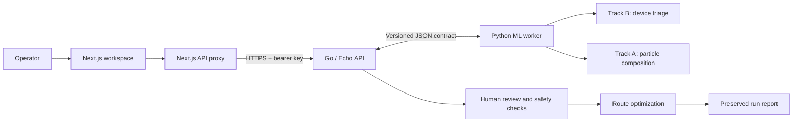

# YieldSense

**Image-assisted e-waste assessment and route planning.**

[Live project](https://yeildsense.atharvas.me/) · [Video demo](https://youtu.be/Az_hLLrgGUE) · [Architecture image](https://ibb.co/B2vPVGwQ)

YieldSense connects batch intake, visual analysis, human safety review and recycling decisions. It combines measured batch weight and material-composition scenarios with processor capacity, recovery rates and costs to recommend eligible processing assignments and preserve the evidence behind them.

## Problem statement

An incoming e-waste batch can contain valuable materials and devices requiring battery inspection. Operators must decide what the batch contains, which handling restrictions apply, and where it should be processed. Composition is uncertain, and processors differ in capacity, recovery performance and economics.

YieldSense brings images, model predictions, inspection evidence and route assumptions into one workflow. Its intended benefit is more consistent, traceable decisions; financial and recovery improvements require validation in a facility pilot.

## What it does

- **Batch intake:** record measured mass, upload images and retain their provenance.
- **Track B — device triage:** classify whole devices across 15 registered categories and flag battery review with a dual-head EfficientNet-B0 model.
- **Track A — particle composition:** use tree-based classification and mass regression on compatible particle imagery to estimate ferrous metal, non-ferrous metal, PCB, plastic and other material.
- **Human safety review:** require documented inspection evidence for approval or battery-state changes. Predictions cannot clear batteries.
- **Route planning:** assign whole batches to authorized processing or hold routes under category, safety and capacity constraints.
- **Optimization and reporting:** compare expected, robust, greedy and fixed-route policies; simulate changed prices or unavailable capacity; preserve inputs, assumptions and results.

A **route** is a processing option with accepted categories, allowed battery states, capacity, recovery rates, prices and costs. Robust planning maximizes the minimum modeled contribution across the supplied, aligned composition scenarios. Track B device probabilities are not material mass fractions.

## Technical architecture

| Layer | Stack | Responsibility |
|---|---|---|
| Frontend | Next.js, React, TypeScript | Operator workspace, image analysis, review, planning and reports |
| API proxy | Next.js route handlers | Forward browser requests and add the backend credential server-side |
| Backend | Go, Echo, AWS SDK for Go v2 | Validation, workflow state, persistence, model registry and branch-and-bound optimization |
| ML worker | Python, PyTorch, scikit-learn, Boto3 | Load registered models and serve CPU inference |
| Persistence | DynamoDB and S3 | Structured records, images, models and report snapshots |



Model manifests record architecture, label order, preprocessing, hashes and provenance. The worker verifies artifacts, and Go validates responses before accepting them. Conditional versions prevent lost updates; prediction evidence and batch changes are committed atomically in DynamoDB.

The proxy keeps the shared API key out of browser bundles. Individual operator authentication is not implemented, so hosted access must remain restricted.

## AWS architecture

[](https://ibb.co/B2vPVGwQ)

The backend and ML worker run together on **ECS/Fargate in ap-south-1**. Cloudflare provides backend DNS; the Next.js frontend is hosted separately.

| AWS service | Use |
|---|---|
| ECS / Fargate Express Mode | Backend and inference containers with managed HTTPS ingress |
| S3 | Private, encrypted, versioned storage for images, model archives and report snapshots |
| DynamoDB | Batches, routes, manifests, predictions and runs; conditional writes, transactions and point-in-time recovery |
| ECR | Container images deployed by digest |
| Secrets Manager and IAM | Credentials and application/resource permissions |
| CloudWatch Logs | Backend and worker logs |
| VPC and gateway endpoints | Application networking and gateway access to S3/DynamoDB |
| CloudFormation | Storage and service infrastructure defined in `infra/` |

**SageMaker is not provisioned by the current deployment.** Locally trained artifacts are served by the ECS worker. The original design proposed SageMaker training and hosting; that remains a separate implementation path.

## Deploy and run

From the repository root, with Docker running and the AWS profile authenticated:

```powershell
./infra/deploy.ps1 `
  -Profile yieldsense-dev `
  -Region ap-south-1 `
  -StackPrefix yieldsense-dev `
  -TableName yieldsense-dev `
  -MaxTasks 1 `
  -UseTemporaryDockerConfig `
  -BuildMLWorker
```

This deploys AWS infrastructure and both containers. Register model archives and configure the frontend separately using the [full-stack guide](docs/full-stack-integration.md). Set API-mode environment variables before building Next.js.

## Research papers and datasets

These sources inform the design and data choices; their published results are not YieldSense performance claims.

| Research paper | Relevance |
|---|---|
| Vogelgesang et al., [Automated material flow characterization of WEEE in sorting plants using deep learning and regression models on RGB data](https://doi.org/10.1016/j.wasman.2025.114904), *Waste Management* (2025) | RGB material identification and particle mass prediction for shredded WEEE |
| Vogelgesang et al., [Material flow composition dataset: RGB-camera-based single-particle images and particle mass data of shredded WEEE](https://doi.org/10.1016/j.dib.2025.112413), *Data in Brief* | Particle-image, mass and mixed-sample data relevant to Track A |
| Rukundo et al., [Annotated datasets for waste electrical and electronic equipment identification and battery detection and classification](https://doi.org/10.1038/s41597-026-07606-4), *Scientific Data* (2026) | XBAT+ RGB/X-ray datasets for device identification and battery research |

Dataset references:

- [RGB-MFCO — TU Darmstadt](https://tudatalib.ulb.tu-darmstadt.de/items/e05efd14-6421-43ba-a9e4-123c536e712a): particle images and mass evidence; the repository lists restricted file access.
- [XBAT+ — Zenodo](https://zenodo.org/records/18022530): whole-device imagery and battery-related annotations.
- [FutuRaM WEEE composition — Zenodo](https://zenodo.org/records/17789750): collection-category composition data for category priors, rather than batch-specific measurements.

YieldSense connects this research to uncertainty-aware route planning. Route fees, recovery assumptions and processor authorization require separate evidence; these datasets do not establish profitability or safety approval.

## Contributors

<table>
  <tr>
    <td width="50%" align="center" valign="top">
      <a href="https://github.com/atharvaSharma17"></a>
      <h3>Atharva Sharma</h3>
      <p><strong>Team leader · Backend, infrastructure, research and system design</strong></p>
      <p>Built the Go/Echo backend and optimization APIs, integrated ML inference, and implemented AWS infrastructure and deployment.</p>
      <p><a href="https://github.com/atharvaSharma17">GitHub</a> · <a href="https://www.linkedin.com/in/atharva-sharma-vit">LinkedIn</a> · <a href="https://drive.google.com/file/d/11hmpiF-EPYXUdguspR3HwZh85SzVOHSS/view?usp=sharing">Resume</a></p>
    </td>
    <td width="50%" align="center" valign="top">
      <a href="https://github.com/diyabajoria"></a>
      <h3>Diya Bajoria</h3>
      <p><strong>Frontend and system design</strong></p>
      <p>Built the Next.js operator interface for batch intake, image analysis, human review, route planning and reports.</p>
      <p><a href="https://github.com/diyabajoria">GitHub</a> · <a href="https://www.linkedin.com/in/diya-bajoria-375367335/">LinkedIn</a> · <a href="https://drive.google.com/file/d/1HBYcWVcVHNXM3Jc4MlZfDyaU3F84nc0h/view?usp=sharing">Resume</a></p>
      <p>WeMakeDevs: <code>diyabajoria</code></p>
    </td>
  </tr>
  <tr>
    <td width="50%" align="center" valign="top">
      <a href="https://github.com/AG0606"></a>
      <h3>Ashutosh Gupta</h3>
      <p><strong>Machine learning</strong></p>
      <p>Developed and trained the device-classification and particle-composition models, evaluated performance, and delivered model artifacts for integration.</p>
      <p><a href="https://github.com/AG0606">GitHub</a> · <a href="https://www.linkedin.com/in/ashutosh-gupta-3848ba350/">LinkedIn</a> · <a href="https://drive.google.com/file/d/1k8ETUCc9cAiK-EdDzX8AIzHB4Ub3itAd/view?usp=sharing">Resume</a></p>
      <p>WeMakeDevs: <code>ashutoshg</code></p>
    </td>
    <td width="50%" align="center" valign="top">
      <a href="https://github.com/YOGESH-08"></a>
      <h3>Yogesh Kumar N</h3>
      <p><strong>Research</strong></p>
      <p>Researched e-waste processing, datasets, safety requirements and recovery methods to inform project requirements and assumptions.</p>
      <p><a href="https://github.com/YOGESH-08">GitHub</a> · <a href="https://www.linkedin.com/in/yogesh-kumar-n-853084310/">LinkedIn</a></p>
      <p>WeMakeDevs: <code>yogesh_kumar</code></p>
    </td>
  </tr>
</table>

## Documentation

- [Backend setup and API](backend/README.md)
- [AWS deployment and operations](infra/README.md)
- [Frontend, models and inference contract](docs/full-stack-integration.md)
- [ML pipeline](ml/README.md)

